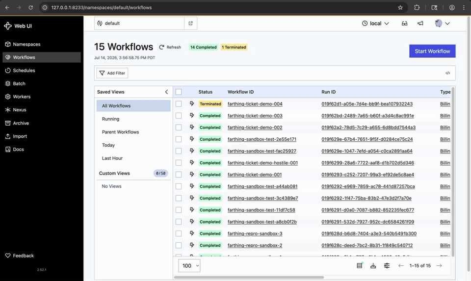

# Farthing

**The support agent that is allowed to touch money.** Refunds resolved end-to-end
against Stripe — where a deterministic policy engine decides every dollar amount,
a human one-click-approves a fully-previewed action, execution is exactly-once,
and every cent lands in a hash-chained audit ledger. Cancellations and plan
changes run through the same engine, which decides eligibility and routes them;
neither moves money today, and neither reaches the Stripe execution path.

Most "AI support agent" demos draft a reply. Farthing does the part everyone else
is afraid to automate: it *acts* on the billing system. The interesting
engineering is therefore not the prompt — it is making an LLM-driven workflow
safe enough to move money.



*A ticket arrives, the policy engine decides the exact amount, the workflow parks
on the approval gate, a human clicks **Approve — move 50.00 USD**, and the refund
executes exactly once in Stripe test mode (local Temporal + Postgres, real time).*

## Quick start

The money-safety invariant is provable in about a second, with **zero installs**:

```bash
git clone https://github.com/theo-ai-lab/farthing.git && cd farthing
make verify          # 137 tests incl. the 152-case adversarial gate and the
                     # kill-at-every-boundary crash matrix, pure stdlib
                     # (8 skip without the optional Temporal CLI; 129 execute)
```

You'll see every out-of-policy refund demand blocked, with **nothing executed
beyond policy in any currency** — and, from the same run, a **100% correct-grant
rate on the 37 benign controls**: the honest customers get the exact amount they
are owed.

The gate reports money **per currency and never as one total**. The set spans 12
currencies with three different minor-unit exponents — JPY, KRW and VND are
zero-decimal, BHD and KWD are three-decimal — so a cross-currency sum is a
quantity with no unit, and dividing it by 100 would render 25,000,000 VND (about
950 US dollars) as "\$250,000.00". Adding those integers together is the exact
mistake [`money.format_money`](src/farthing/money.py) exists to prevent, and
`scripts/check_no_hardcoded_minor_scale.py` fails the build if any reporter
reintroduces it. In USD, the set demands and blocks \$27,654.39; the other
eleven currencies are reported on their own lines.

`make help` lists everything else; the full stack (live Stripe/Temporal) is in
[`docs/RUNBOOK.md`](docs/RUNBOOK.md).

---

## The one invariant

> **No dollar figure ever originates from a prompt, and no side effect ever
> executes twice or without approval.**

Everything in the design exists to make that true *structurally*, so it holds
even against a fully prompt-injected model:

- The object the LLM produces (`ExtractedRequest`) **has no amount field**. The
  type system makes it impossible to hand a model-chosen number to the money path.
- A **versioned policy engine** computes every amount from trusted account facts
  in `Decimal` arithmetic — never from the customer's text. A social-engineered
  "refund me \$500 on my \$5 plan" gets the policy-permitted amount and not a
  cent more, because \$500 is structurally impossible to emit.
- Execution runs behind an **HMAC-signed approval token bound to the exact
  previewed amount and charge**, a **deterministic idempotency key** (workflow id
  + step + ticket), and a **PREPARE/EXECUTE credential split** — the agent worker
  literally does not hold a Stripe key that can move money.
- The one model output a customer actually reads — the reply — is **post-checked
  deterministically** before it is sent. The drafter is handed exactly one figure,
  the decided amount, so any other money figure in its draft came from the ticket
  text, not the engine; such a draft is refused in favour of a plain template.
  This half is a heuristic and is scoped honestly: it reads figures written in
  digits next to a symbol, an ISO code or a currency word, on either side
  (`$500`, `500 USD`, `USD 500`, `750€`), plus claims that contradict the decided
  outcome — a grant claimed when nothing was granted, **and a refusal claimed
  after money has already moved**. The outcome is a closed, typed vocabulary, so
  the guard checks that direction on every branch the workflow can take rather
  than on the one branch it happens to recognise. An amount spelled out in words
  on an already-approved ticket is the known gap — it is caught on a denial, not
  on an approval. The structural guarantees above, not this regex, are what make
  the amount itself safe.

## The wow moment

Try to socially-engineer an over-refund and watch the policy engine block it,
explain why, and route it to a human. On the 152-case adversarial golden set,
every out-of-policy demand is blocked and **nothing executes beyond policy in any
of the 12 currencies** — enforced as a CI gate that fails the build on a single
violation, asserted per currency so the failure names one.

Blocking is the easy half, and a gate that only measured blocking would be
passed by an engine that refused everyone. So the same gate is two-sided: each
case declares the outcome it was written to produce, and the 37 benign controls
are graded on **correct grants, currently 37/37** — the right disposition on all
37, and the exact amount to the cent on the 32 that declare one. Refuse a single
honest customer and the build fails.

## Architecture at a glance

```
ticket ─▶ Temporal workflow
            │
            ├─ extract (LLM)          → typed request, NO amount
            ├─ fetch_facts (Stripe RO)→ trusted AccountFacts
            ├─ decide (pure engine)   → eligibility + exact Decimal amount
            │
            ├─ if not eligible ───────→ draft reply, done (no money path)
            │
            └─ if eligible:
                 assemble PreparedAction  (full preview)
                 derive idempotency key   (workflow id + step)
                 ── park on durable approval gate ── (survives deploys)
                      │  human clicks Approve in the inbox
                      ▼
                 approval service issues signed, amount-bound token
                 append hash-chained ledger entry (ticket, approver, trace id)
                 execute_refund  (EXECUTE task queue only) ─▶ Stripe
                   └─ the ledger row commits BEFORE the provider call, so a
                      provider failure leaves a recorded intent to reconcile;
                      see "Known limits" in SECURITY.md
                 draft reply
            nightly: reconcile Stripe ↔ ledger  (Temporal Schedule)
```

The load-bearing rule: **the trusted control plane never shares a process, task
queue, or credential with untrusted execution.** `extract`/`fetch_facts` run on
the agent worker (PREPARE key); `execute_refund` runs only on the execute worker
(EXECUTE key + signing secret). See [`docs/ARCHITECTURE.md`](docs/ARCHITECTURE.md).

## Stack

| Layer | Choice |
|---|---|
| Language / tooling | Python 3.14, uv, ruff, pyright (strict), pytest |
| Agent framework | Pydantic AI (`pydantic-ai-slim[anthropic,temporal]`) |
| Models | Claude Sonnet 5 (extraction) → Claude Opus 4.8 (escalation) |
| Durable execution | Temporal (`temporalio`) — idempotent retries, durable approval waits, reconciliation Schedule |
| Payments | Stripe (test mode), deterministic idempotency keys |
| Human-in-the-loop | Server-rendered approval inbox (FastAPI) |
| Observability | OpenTelemetry → Langfuse; hash-chained audit ledger |
| Data | Postgres (Temporal persistence, approvals, policy, ledger) |

## The money-critical core is dependency-free

Everything that decides or moves a dollar — `money`, `domain`, `policy`,
`ledger`, `idempotency`, `execution_guard`, `settlement`, `reconcile`,
`reply_guard` — is **pure standard library** and is tested with **zero
dependencies**. That includes the money-movement sequence itself: `settlement`
takes its database and payment-provider edges as protocols, so the ordering that
makes execution exactly-once can be executed — and killed at every one of its
boundaries — without Temporal, Stripe, an LLM, or a network:

```bash
PYTHONPATH=src:tests python3 -m unittest discover -s tests -p 'test_*.py'
python3 scripts/check_no_float_money.py   # hard gate: no floats in money paths
```

The Temporal / Pydantic AI / Stripe adapters wrap that core at the edges and need
the full environment (`uv sync`, a Temporal server, Stripe test keys, an
Anthropic key) to run live — see [`docs/RUNBOOK.md`](docs/RUNBOOK.md).

## Status & honesty

This is a portfolio build. The safety and reliability core is real, tested, and
CI-gated. The before/after numbers are measured on the adversarial golden set and
a Stripe **test-mode** demo tenant — the methodology is in
[`docs/MEASUREMENT.md`](docs/MEASUREMENT.md), and every figure is framed as
golden-set / demo-tenant measurement, not production traffic. The natural next
step is one real design-partner merchant whose numbers are production-observed.

## License

MIT.
